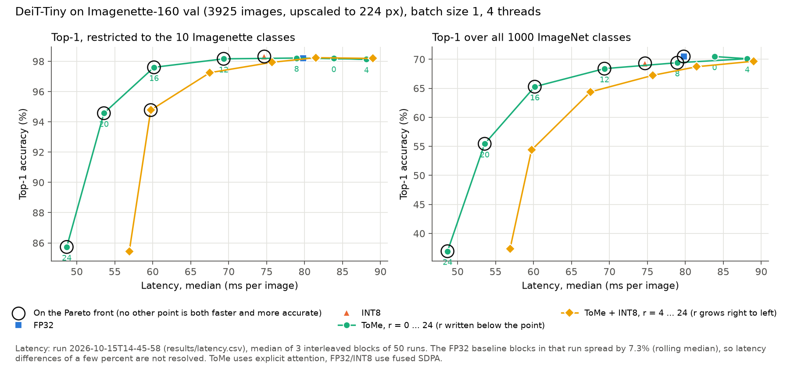
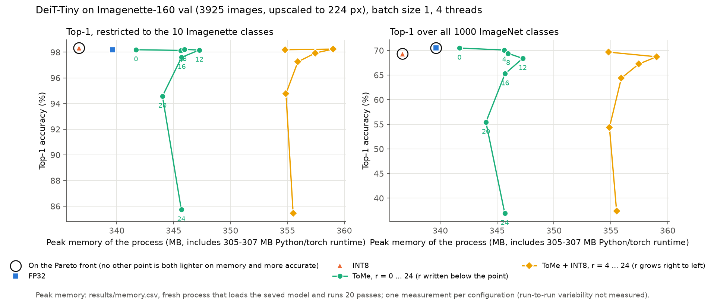
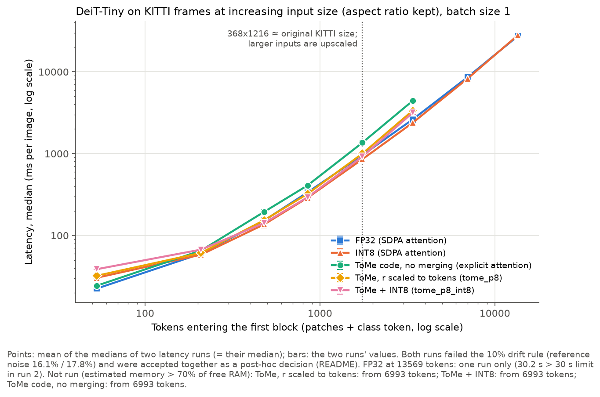
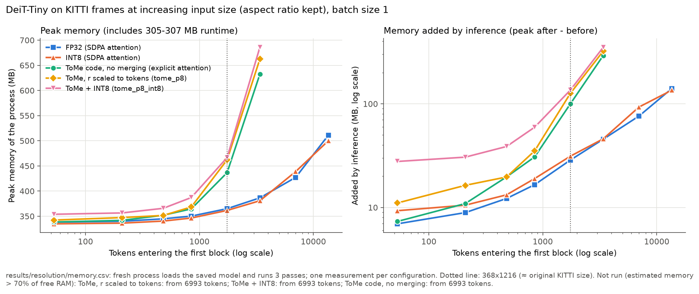
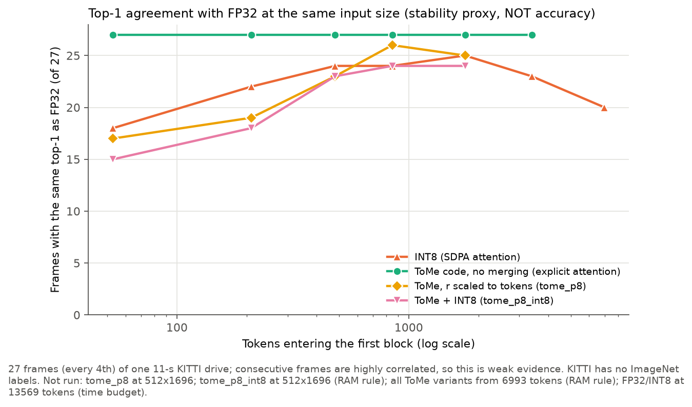
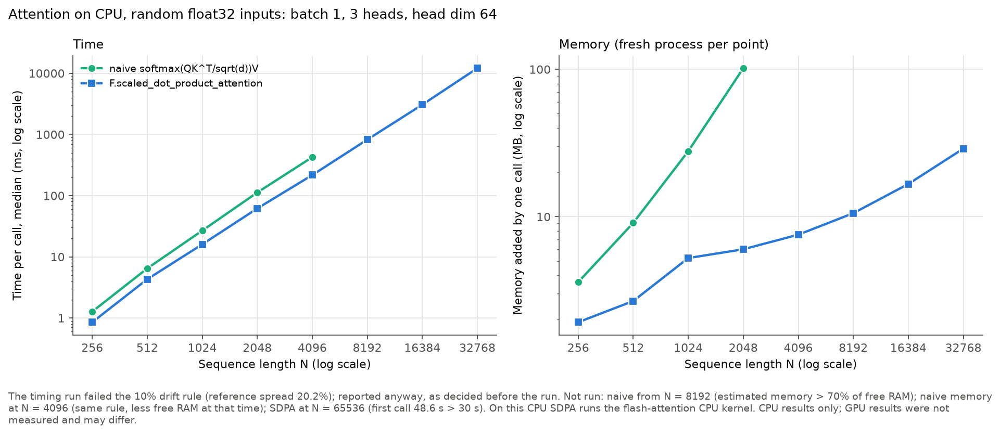

# Efficient Vision Transformers on CPU

**Token merging and INT8 quantization trade-offs, with resolution scaling on driving images**

A small measurement study of DeiT-Tiny on a 4-core laptop CPU (no GPU, 6 GB RAM).
Every number below comes from a CSV in `results/` produced by the code in `src/`;
decisions, failures and irregularities are logged in [`results/NOTES.md`](results/NOTES.md).
All tables: [`results/summary_tables.md`](results/summary_tables.md) (generated by `src/tables.py`).

## Main findings

1. **On this CPU, the attention kernel decides how far the token count can grow, more
   than token merging does.** On KITTI frames, FP32 and INT8 (timm's fused
   `scaled_dot_product_attention`) ran up to 13569 tokens (1024x3392 input), where one
   pass takes 27516.55 ms (FP32, one run) and 28136.63 ms (INT8), right at the 30 s time
   limit. All ToMe variants use the official ToMe code, which computes attention
   explicitly (N x N matrix). They were stopped at 6993 tokens because their estimated
   memory exceeded the free RAM, while FP32 at 6993 tokens peaked at 427.21 MB.
2. **ToMe did not make high-resolution inference cheaper than FP32 here.** At 368x1216
   (1749 tokens, the size closest to the original KITTI frame), ToMe with r scaled to
   the input (`tome_p8`, 1749 -> 897 tokens) took 1000.71 ms vs 958.83 ms for FP32, and
   peaked at 462.10 MB vs 364.98 MB. The same ToMe code without merging (`tome_r0`)
   took 1362.85 ms and 436.62 MB: merging recovers most of the cost of the explicit
   attention, but not more. Peak memory does not fall with merging because block 0
   always attends over all tokens before the first merge.
3. **At 224 px (Imagenette), ToMe gives a clear speed-up only from r = 12 on.** FP32:
   79.79 ms, 98.19% top-1 (10 Imagenette classes), 70.47% (1000 classes). ToMe r = 12:
   69.34 ms, 98.17% / 68.38%. r = 16: 60.17 ms, 97.61% / 65.27%. r = 24: 48.68 ms but
   85.73% / 36.94%. r = 8 (78.94 ms) is within the run's noise of FP32.
4. **INT8 dynamic quantization cut the model file from 21.85 MB to 6.15 MB** with
   98.32% / 69.30% top-1 (vs 98.19% / 70.47%). Its latency (74.70 ms vs 79.79 ms) and
   peak memory (336.69 vs 339.64 MB, of which 305-307 MB is the Python/torch runtime)
   are not clearly different from FP32 in these measurements.
5. **ToMe + INT8 was slower than ToMe alone at every r on Imagenette** (e.g. r = 16:
   67.52 ms vs 60.17 ms) and used more peak memory (355.93 vs 345.70 MB). Measured; the
   cause was not measured.
6. **Synthetic attention (batch 1, 3 heads, head dim 64):** `F.scaled_dot_product_attention`
   (on this CPU: PyTorch's flash-attention CPU kernel) was faster than naive
   softmax(QK^T/sqrt(d))V at every N (0.853 vs 1.272 ms at N = 256, 216.903 vs
   425.503 ms at N = 4096). One call added 6.01 MB vs 101.70 MB at N = 2048, and SDPA
   added only 28.95 MB at N = 32768. Naive attention was stopped at N = 8192 by the
   memory rule; SDPA at N = 65536 by the time limit (first call 48.6 s).

These are CPU measurements on one laptop. Nothing here was measured on a GPU or in a
car, and no claim is made about real-time driving performance.

## Figures

| | |
|---|---|
|  |  |
| Imagenette: accuracy vs latency (Pareto view) | Imagenette: accuracy vs peak memory |
|  |  |
| KITTI: latency vs tokens | KITTI: peak memory and inference memory vs tokens |
|  |  |
| KITTI: top-1 agreement with FP32 (stability proxy) | Naive attention vs SDPA |

## Main results tables

### Imagenette (DeiT-Tiny, 224 px, batch 1)

| method | top-1 10-class (%) | top-1 1000-class (%) | latency median (ms) | latency p95 (ms) | throughput (img/s) | peak memory (MB) | size on disk (MB) | tokens after last block |
|---|---|---|---|---|---|---|---|---|
| fp32 | 98.19 | 70.47 | 79.79 | 120.55 | 12.53 | 339.64 | 21.85 | 197 |
| int8 | 98.32 | 69.30 | 74.70 | 90.16 | 13.39 | 336.69 | 6.15 | 197 |
| tome_r0 | 98.19 | 70.47 | 83.85 | 104.96 | 11.93 | 341.69 | 21.85 | 197 |
| tome_r8 | 98.22 | 69.40 | 78.94 | 139.17 | 12.67 | 345.97 | 21.85 | 101 |
| tome_r12 | 98.17 | 68.38 | 69.34 | 84.95 | 14.42 | 347.25 | 21.85 | 53 |
| tome_r16 | 97.61 | 65.27 | 60.17 | 74.21 | 16.62 | 345.70 | 21.85 | 11 |
| tome_r24 | 85.73 | 36.94 | 48.68 | 58.40 | 20.54 | 345.68 | 21.85 | 2 |
| tome_r8_int8 | 98.24 | 68.71 | 81.50 | 103.99 | 12.27 | 359.02 | 6.15 | 101 |
| tome_r16_int8 | 97.25 | 64.38 | 67.52 | 108.38 | 14.81 | 355.93 | 6.15 | 11 |
| tome_r24_int8 | 85.45 | 37.38 | 56.92 | 74.66 | 17.57 | 355.51 | 6.15 | 2 |

All r = 4 ... 24 values are in `results/accuracy.csv`, `results/latency.csv` and
`results/memory.csv`. On 3925 images, one image is 0.025 percentage points.

### KITTI resolution scaling, near the original size and the largest sizes

| input (HxW) | tokens in | method | tokens after last block | latency median (ms) | run 1 / run 2 (ms) | peak memory (MB) | top-1 same as FP32 |
|---|---|---|---|---|---|---|---|
| 368x1216 | 1749 | fp32 | 1749 | 958.83 | 921.27 / 996.39 | 364.98 | - |
| 368x1216 | 1749 | int8 | 1749 | 854.68 | 818.55 / 890.81 | 361.53 | 25/27 |
| 368x1216 | 1749 | tome_r0 | 1749 | 1362.85 | 1293.72 / 1431.97 | 436.62 | 27/27 |
| 368x1216 | 1749 | tome_p8 | 897 | 1000.71 | 969.00 / 1032.41 | 462.10 | 25/27 |
| 368x1216 | 1749 | tome_p8_int8 | 897 | 920.66 | 886.75 / 954.57 | 466.50 | 24/27 |
| 736x2432 | 6993 | fp32 | 6993 | 8626.29 | 8336.16 / 8916.41 | 427.21 | - |
| 736x2432 | 6993 | int8 | 6993 | 8291.20 | 7832.26 / 8750.14 | 438.75 | 20/27 |
| 736x2432 | 6993 | all ToMe variants | | skipped (memory) | | | |
| 1024x3392 | 13569 | fp32 | 13569 | 27516.55 | 27516.55 / skipped (time) | 511.36 | not run |
| 1024x3392 | 13569 | int8 | 13569 | 28136.63 | 27018.76 / 29254.50 | 500.30 | not run |

All 8 sizes from 64x208 (53 tokens) up: [`results/summary_tables.md`](results/summary_tables.md).
"Top-1 same as FP32" is a **stability proxy, not accuracy** (see Limitations).

### Attention scaling (synthetic)

| N | naive time median (ms) | naive memory added (MB) | sdpa time median (ms) | sdpa memory added (MB) |
|---|---|---|---|---|
| 256 | 1.272 | 3.60 | 0.853 | 1.92 |
| 1024 | 26.819 | 27.81 | 15.997 | 5.24 |
| 2048 | 112.470 | 101.70 | 61.753 | 6.01 |
| 4096 | 425.503 | skipped | 216.903 | 7.55 |
| 8192 | skipped | skipped | 823.738 | 10.56 |
| 32768 | skipped | skipped | 12086.211 | 28.95 |
| 65536 | skipped | skipped | skipped | skipped |

## Method

**Hardware and software** (`results/environment.json`): AMD Ryzen 5 3500U (4 cores /
8 threads), 5.91 GB RAM, Windows 11, Windows power mode "Best power efficiency", on AC
power. Python 3.12.6, torch 2.14.1+cpu, timm 1.0.30, torchao 0.18.0, onnxruntime 1.31.0.
`torch.set_num_threads(4)`, seed 0, batch size 1 everywhere.

**Model and methods** (`src/models.py`):
- FP32: `deit_tiny_patch16_224` from timm, pretrained on ImageNet-1k, no retraining.
  timm uses fused `F.scaled_dot_product_attention`.
- ToMe: the official [facebookresearch/ToMe](https://github.com/facebookresearch/ToMe)
  code (commit `af95e4b`), unchanged. Its authors tested it with timm 0.4.12;
  compatibility with timm 1.0.30 was checked (`src/tome_compat_check.py`): r = 0
  reproduces timm, token counts follow the paper, and the merge step equals a reference
  written from the paper. Constant r per block, proportional attention on. ToMe computes
  attention explicitly, so `tome_r0` (no merging) is reported as a kernel control.
- INT8: `torch.ao.quantization.quantize_dynamic` on all 49 `nn.Linear` layers (qint8
  weights, activations quantized at run time). torchao's `quantize_` was also tried,
  but in eager mode it took 1859-1958 ms per image vs 54-64 ms for FP32 on this CPU,
  so it was not used (`results/int8_api_check.json`, `results/NOTES.md`). The `torch.ao` API is deprecated but works in torch 2.14.1.
- ToMe + INT8: ToMe patch first, then the same quantization.

**Experiment 1, Imagenette** (`src/accuracy.py`): the full Imagenette-160 validation set
(3925 images), upscaled to 224 px by the model's timm preprocessing. Top-1 restricted to
the 10 Imagenette classes (argmax over their 10 logits), and unrestricted over all 1000.
The class mapping was built from the WordNet IDs and verified (`src/class_mapping.py`).

**Experiment 2, KITTI resolution scaling** (`src/resolution.py`): 108 frames of the left
colour camera of KITTI raw drive `2011_09_26_drive_0001_sync` (1242x375 px). Inputs keep
the aspect ratio: heights 64 ... 1024, widths rounded to multiples of 16 (53 to 13569
tokens). timm's `dynamic_img_size=True` interpolates the position embedding on every
forward pass; checked to give identical outputs at 224x224, and the token count was
verified at every size. A constant r = 8 does not transfer across sizes, so `tome_p8`
uses r = round(8 x patches / 196), the same fraction per block as r = 8 at 224.
Without labels, accuracy is not reported; instead top-1 agreement with FP32 at the same
size on 27 frames.

**Experiment 3, attention scaling** (`src/attention.py`): random float32 Q, K, V of shape
1 x 3 x N x 64 (DeiT-Tiny's heads), N = 256 ... 65536. Both implementations give the same
output (max difference 2.98e-7); the profiler shows the CPU flash-attention kernel for SDPA.

**Timing** (`src/bench.py`, `src/latency.py`): latency excludes image loading and
preprocessing. 10 warm-up + 50 timed runs per block; for very slow configurations fewer
(minimum 2 warm-up, 5 timed; numbers are in the CSVs). A 180 s untimed heat-up first.
FP32 reference blocks are interleaved between configurations to detect thermal drift
(rule B: rolling median of 3 reference blocks may vary by at most 10%). Reported
latency is a median, p95 is over all timed runs.

**Peak memory** (`src/memory.py`, `src/memory_worker.py`): each configuration is built,
saved and checked to reload to identical outputs; a fresh process then only loads and
runs it, and the peak working set is read. Values include the Python/torch runtime
(305-307 MB).

**Limits** (decided before the runs): skip a configuration if its largest tensor is
estimated above 1.5 GB, its estimated peak above 70% of the RAM free at that moment, or
one pass takes over 30 s. Skips are recorded in the CSVs, not hidden.

## Post-hoc decisions (taken after seeing data)

Each is documented in `results/NOTES.md` with the data that led to it.

- **Rule B** (180 s heat-up, rolling-median drift check) was defined after a rejected
  Phase 3 latency run showed the laptop slows down under sustained load. It was applied
  only to runs made afterwards.
- **KITTI latency (decision A):** both full latency runs failed rule B (reference noise
  16.1% and 17.8%, no steady trend). Instead of a third run, both were accepted
  together: each configuration's latency is the mean of the two run medians, and both
  values are shown. Run-to-run difference over 33 configurations: median 7.6%, max
  21.6%. Differences between methods smaller than this are not resolved, which
  includes most INT8 vs FP32 and `tome_p8` vs FP32 comparisons at the same size.
- **Phase 1 FP32 latency (93.31 ms) was replaced** after later runs gave about 60-62 ms
  for the same configuration while other programs had been open; the cause is not proven.
- **Scaled r for KITTI (`tome_p8`)** was chosen after a pilot showed constant r = 8
  removes almost all tokens at small sizes and almost none at large sizes.
- **DeiT-Small was skipped** (decided with the user) because of the time limits; no
  DeiT-Small number was measured.

Decided **before** its run: the attention timing run would be reported even if it failed
rule B. It did fail (reference spread 20.2%), and it is reported with that noise.

## Limitations

- **One laptop, noisy timing.** Reference noise was 7.3% in the Imagenette latency run
  and 16-20% in the long KITTI and attention runs. Small latency differences are not
  meaningful.
- **Free RAM, not the 6 GB total, set the memory limits.** Only about 0.8-1.5 GB was
  free during the runs, so several skips depend on the machine's state at that moment
  (e.g. `tome_p8` agreement at 512x1696 was skipped although its latency and memory
  were measured earlier). The memory estimates were sometimes too low (by up to 12.45 MB
  for ToMe on KITTI, and by about 85 MB for the attention runtime).
- **Peak memory was measured once per configuration**; its run-to-run variability is unknown.
- **KITTI agreement is only a stability proxy:** no labels, 27 frames from one 11-second
  drive, consecutive frames highly correlated. Inputs above 368x1216 are upscaled and
  contain no extra image detail; they only show how cost grows with tokens.
- **ToMe vs FP32 mixes two effects:** merging and the explicit attention kernel. ToMe
  with SDPA was not tested.
- **One model (DeiT-Tiny), one easy dataset** (10 Imagenette classes, upscaled from 160 px).
- **CPU only.** Memory-efficient attention kernels mainly target GPUs; GPU results were
  not measured and may differ. ONNX Runtime INT8 (optional) was not done.

## Reproduce

```
pip install -r requirements.txt
cd src
python data_check.py && python environment.py
python accuracy.py --method fp32      # Imagenette; repeat for int8, tome_r0 ... tome_r24_int8
python latency.py --methods ... --repeats 3 && python memory.py --methods ...
python resolution.py latency      # needs KITTI frames in data/kitti/
python resolution.py merge --run-ids 2026-10-15T17-23-30 2026-10-15T21-17-16
python resolution.py memory && python resolution.py agreement
python attention.py check && python attention.py timing && python attention.py memory
python plots.py && python tables.py
```

Data (Imagenette, KITTI) is not included; see `data/` paths in `src/common.py` and
`src/resolution.py`.
